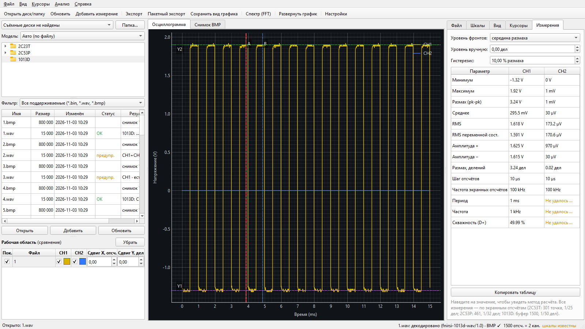
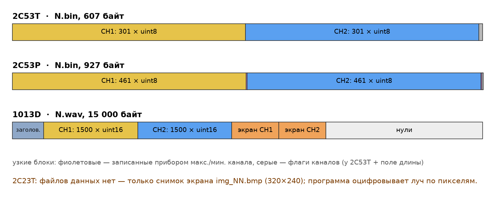
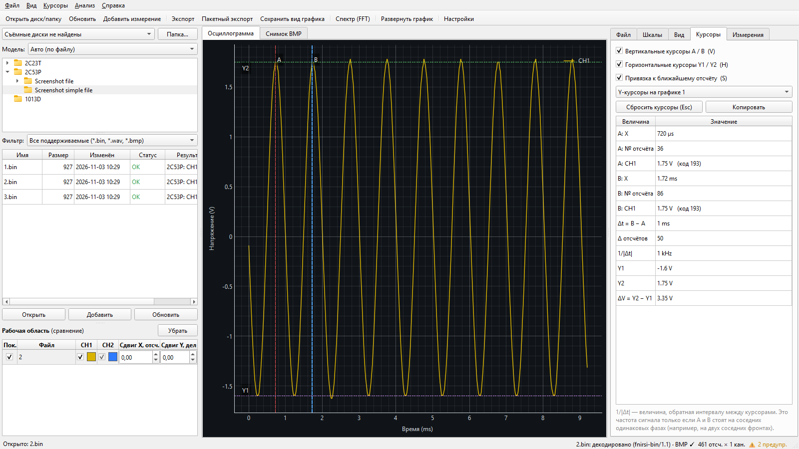
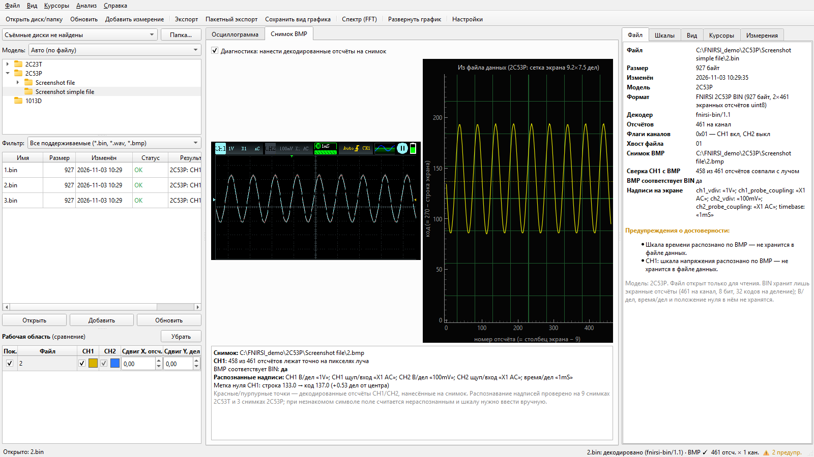
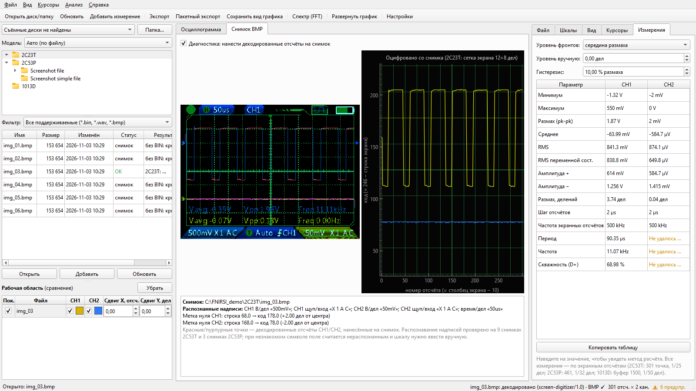
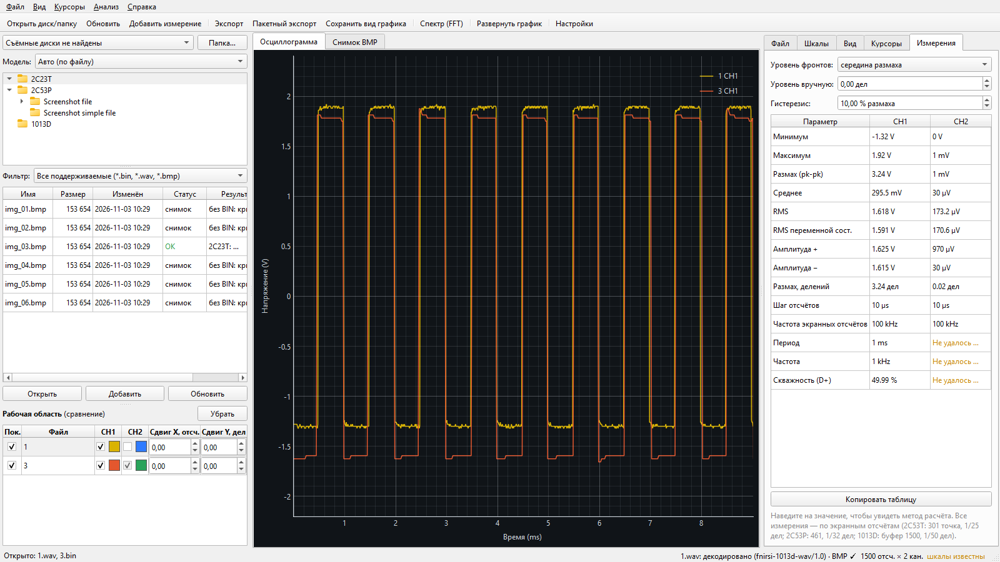
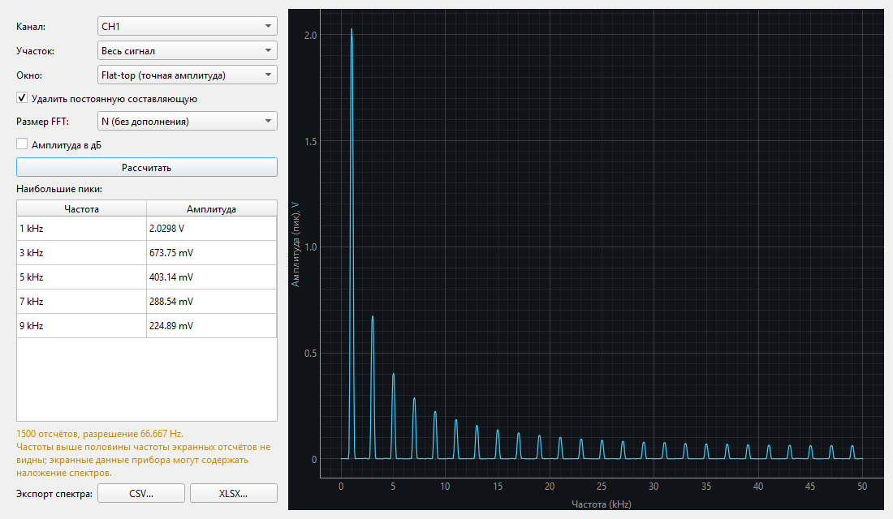
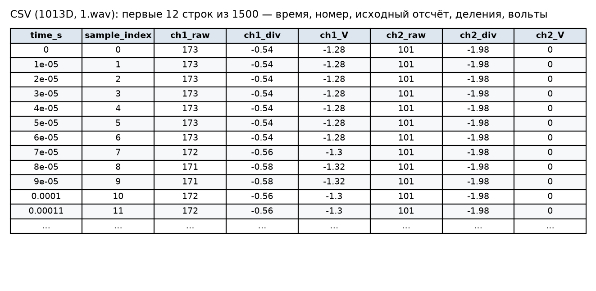

# FNIRSI-2C53T-Decoder

[](https://github.com/lexus2026HA/FNIRSI-2C53T-Decoder/actions/workflows/tests.yml)


Программа для Windows, которая открывает сохранённые осциллограммы портативных осциллографов
**FNIRSI 2C53T, 2C53P, 2C23T и 1013D**, рисует их, позволяет мерить курсорами, считает параметры
сигнала и спектр и выгружает данные в **CSV, XLSX, JSON, PNG, SVG, PDF**.
Работает без установленного Python и без Microsoft Office. Исходные файлы на приборе только читаются.

*A Windows viewer/analyser for waveforms saved by FNIRSI 2C53T, 2C53P, 2C23T and 1013D scopes:
cursors, automatic measurements, FFT, export to CSV/XLSX/JSON/PNG/SVG/PDF. UI in Russian.*



## Поддерживаемые приборы

| Модель | Что сохраняет прибор | Что делает программа | Откуда шкалы |
|---|---|---|---|
| **2C53T** | `N.bin` (607 Б) + снимок `N.bmp` 320×240 | 2 × 301 экранный отсчёт | со снимка (распознавание надписей) или вручную |
| **2C53P** | `Screenshot simple file\N.bin` (927 Б) + `Screenshot file\N.bmp` 480×272 | 2 × 461 экранный отсчёт | со снимка или вручную |
| **2C23T** | только снимок `img_NN.bmp` 320×240 | оцифровывает луч по пикселям (±1 px) | со снимка |
| **1013D** | `N.wav` (15 000 Б, данные + настройки) + `N.bmp` 800×480 | 2 × 1500 отсчётов буфера | из файла WAV |

Модель определяется автоматически по файлу или выбирается вручную в левой панели («Модель»).
Каждое значение шкалы помечено источником: **из файла данных**, **распознано по BMP**,
**введено вручную** или **неизвестно** — программа не подставляет «удобных» значений по умолчанию.



## Скачать и запустить

1. Скачайте архив `FNIRSI-2C53T-Decoder-win64.zip` со страницы
   [Releases](https://github.com/lexus2026HA/FNIRSI-2C53T-Decoder/releases).
2. Распакуйте **всю папку** и запустите `FNIRSI-2C53T-Decoder.exe` (рядом должна лежать папка `_internal`).
3. Подключите осциллограф по USB: он определяется как съёмный диск и появляется в списке слева.
   Можно также выбрать любую папку кнопкой **Папка…** — например, `samples` из архива.

Подробная инструкция с картинками: [docs/USER_GUIDE.md](docs/USER_GUIDE.md).

## Возможности

- **Файлы:** список съёмных дисков (опрос каждые 2 с), дерево папок, таблица файлов со статусом
  декодирования, фильтры, пакетная обработка; отключение диска и битые файлы не роняют программу.
- **График:** CH1/CH2 вместе или раздельно, оси «время — напряжение», «номер отсчёта — код»,
  «деления»; масштаб колесом, перемещение мышью, точки отсчётов, толщина и цвет линий.
- **Курсоры:** вертикальные A/B и горизонтальные Y1/Y2, привязка к отсчётам, Δt, 1/|Δt|, ΔV,
  подсказка с координатами ближайшего отсчёта, копирование значений.
- **Измерения:** мин., макс., размах, среднее, RMS, RMS переменной составляющей, амплитуды,
  период, частота, скважность (по фронтам с гистерезисом); «Недостаточно данных» вместо случайных чисел.
- **FFT:** окна Ханна/Хэмминга/Блэкмана/flat-top, участок между курсорами, удаление постоянной
  составляющей, пики, экспорт спектра.
- **Сверка со снимком:** отсчёты наносятся на BMP прибора, считается доля совпавших пикселей.
- **Сравнение** нескольких измерений, в том числе с разных приборов, с явными сдвигами.
- **Экспорт:** CSV (машинный или «для русского Excel»), XLSX (листы Waveform / Measurements /
  Metadata / FFT), JSON, PNG/SVG/PDF; сессии анализа в JSON.

| Курсоры (2C53P) | Сверка со снимком прибора |
|---|---|
|  |  |
| **Оцифровка снимка 2C23T** | **Два прибора на одном графике** |
|  |  |
| **Спектр (FFT)** | **Экспорт в таблицу** |
|  |  |

## Горячие клавиши

`Ctrl+O` папка · `F5` обновить · `Ctrl+Shift+O` добавить измерение · `Ctrl+E` экспорт ·
`Ctrl+Shift+E` пакетный экспорт · `Ctrl+S` сохранить график · `F` спектр · `F11` развернуть график ·
`Ctrl+0` сброс масштаба · `V` курсоры A/B · `H` курсоры Y1/Y2 · `S` привязка · `Esc` сброс курсоров ·
`Ctrl+Shift+C` копировать отсчёт под мышью.

## Точность и ограничения

- 2C53T/2C53P сохраняют **экранные** отсчёты: 301 / 461 точка, разрешение 1/25 и 1/32 деления.
  Измерения прибора по полной записи могут немного отличаться.
- 1013D сохраняет буфер на 1500 точек (30 делений) и все настройки — это самый «честный» формат.
  Снимок и данные сохраняются разными кнопками, поэтому кадры могут не совпадать.
- 2C23T не сохраняет данные вообще; оцифровка снимка даёт ±1 пиксель, размах выходит на 2–10 % ниже
  показаний прибора (тонкие вершины теряются).
- Распознавание надписей знает только символы, встреченные в образцах; незнакомый символ →
  поле «не распознано», шкала вводится вручную.
- Прошивки 1013D от Peco и Atlan пока не поддерживаются (другая раскладка файла).

Подробно о форматах: [docs/FORMAT.md](docs/FORMAT.md). Проверки: [docs/TESTING.md](docs/TESTING.md).

## Запуск из исходников, тесты, сборка

```bat
py -3.12 -m venv .venv
.venv\Scripts\python -m pip install -r requirements.txt pyinstaller
.venv\Scripts\python run_app.py
.venv\Scripts\python -m pytest -q tests
build\build.bat
```

`build\build.bat` прогоняет тесты, собирает `dist\FNIRSI-2C53T-Decoder\` (PyInstaller),
выполняет самопроверку exe (`--selftest`) и упаковывает zip.

### Тесты

Образцы 2C53P, 2C23T и 1013D из `samples/` сняты автором. Образцы 2C53T взяты из репозитория
[RafaelDiasCampos/FNIRSI-2C53T-Decoder](https://github.com/RafaelDiasCampos/FNIRSI-2C53T-Decoder),
у которого не указана лицензия, поэтому здесь они не выкладываются. Чтобы прогнать тесты 2C53T,
скопируйте его `sample_captures/*.bin` и `*.bmp` в `samples/`; без них эти тесты пропускаются.

## Структура

```
src/fnirsi2c53t/decoders/      декодеры BIN/WAV, анализ и оцифровка BMP, профили моделей, шаблоны глифов
src/fnirsi2c53t/analysis/      измерения, курсоры, FFT
src/fnirsi2c53t/exporters/     CSV, XLSX, JSON, PNG/SVG/PDF, пакетный экспорт
src/fnirsi2c53t/gui/           интерфейс (PySide6 + pyqtgraph)
tools/                         обучение шаблонов глифов, скриншоты, иллюстрации
tests/  samples/  docs/  build/
```

## Благодарности

- Формат 2C53T: RafaelDiasCampos — [FNIRSI-2C53T-Decoder](https://github.com/RafaelDiasCampos/FNIRSI-2C53T-Decoder).
- Формат 1013D: Robert Tidey — [FNISR1013DScope](https://github.com/roberttidey/FNISR1013DScope),
  W. Voigt — [FNIRSI-1013D-WAV-Viewer-in-Excel-VBA](https://github.com/wavoigt/FNIRSI-1013D-WAV-Viewer-in-Excel-VBA).
  Алгоритмы переписаны заново и проверены на файлах с реальных приборов; код не копировался.

Программа не связана с компанией FNIRSI; названия моделей используются только для указания совместимости.

## Лицензия

[CC BY-NC 4.0](LICENSE) — можно использовать, изменять и распространять с указанием авторства;
коммерческое использование запрещено.
