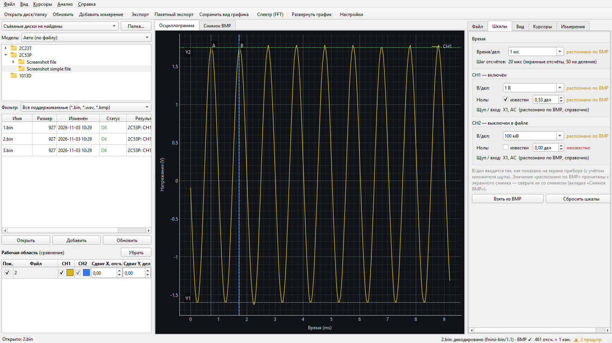
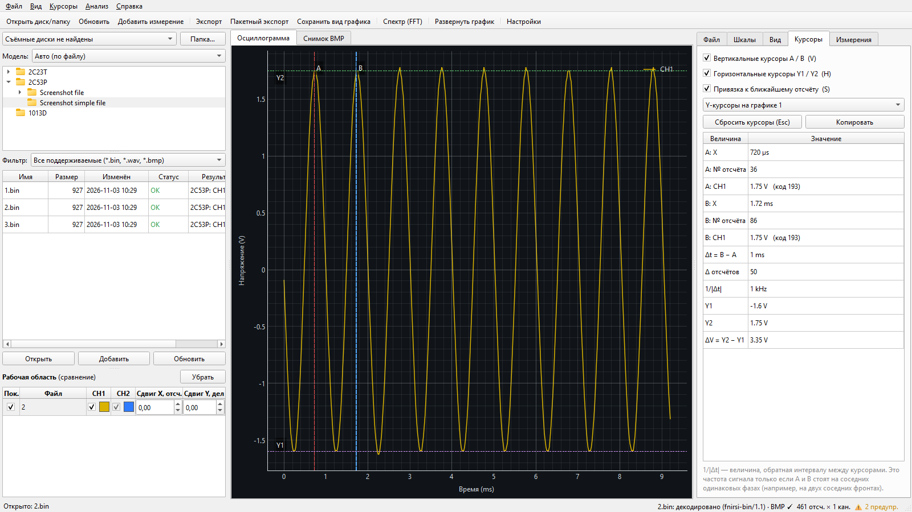
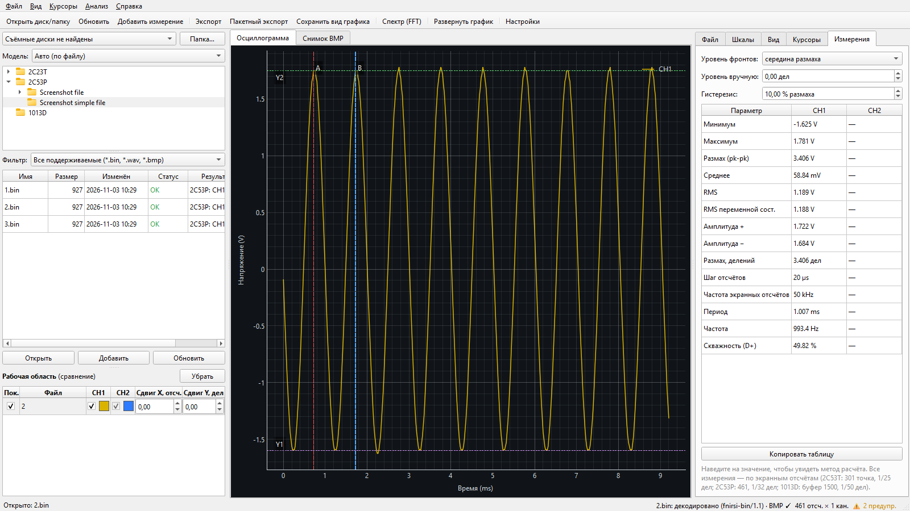
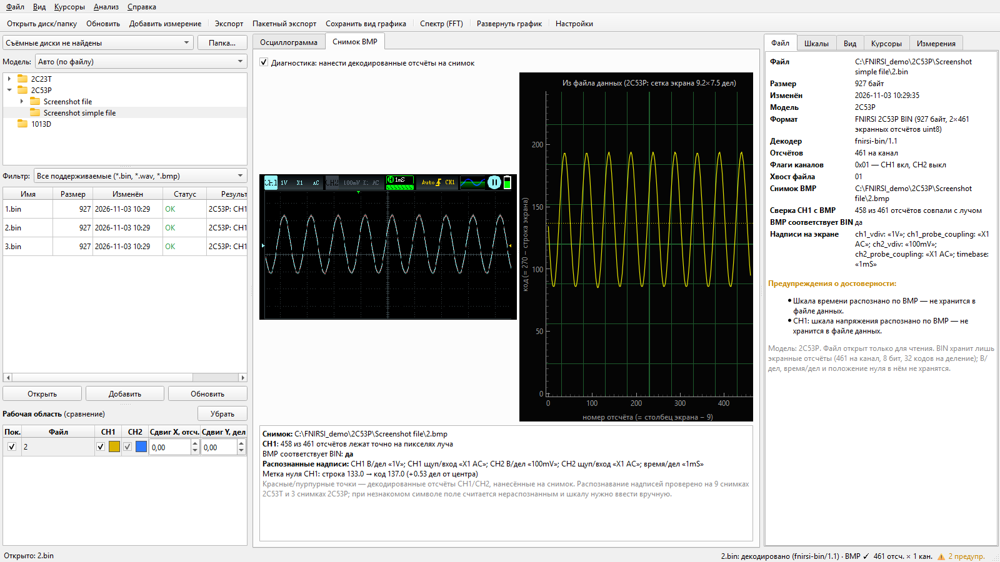
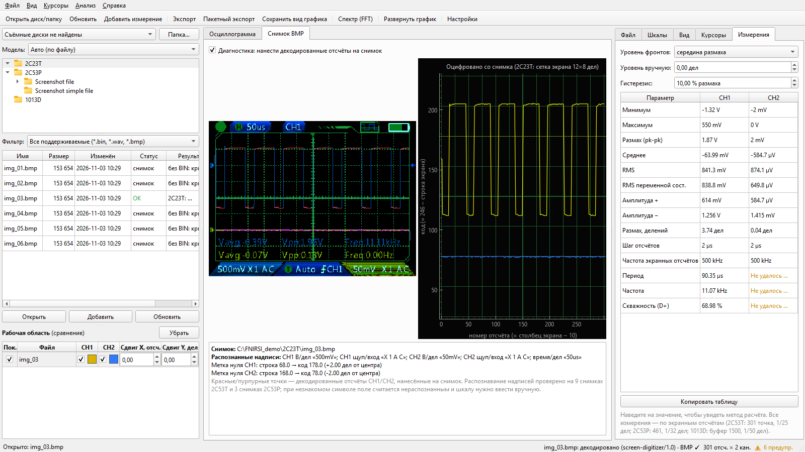
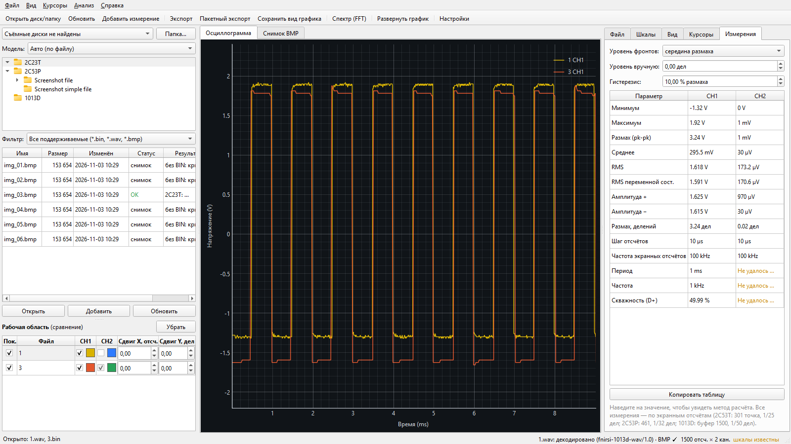
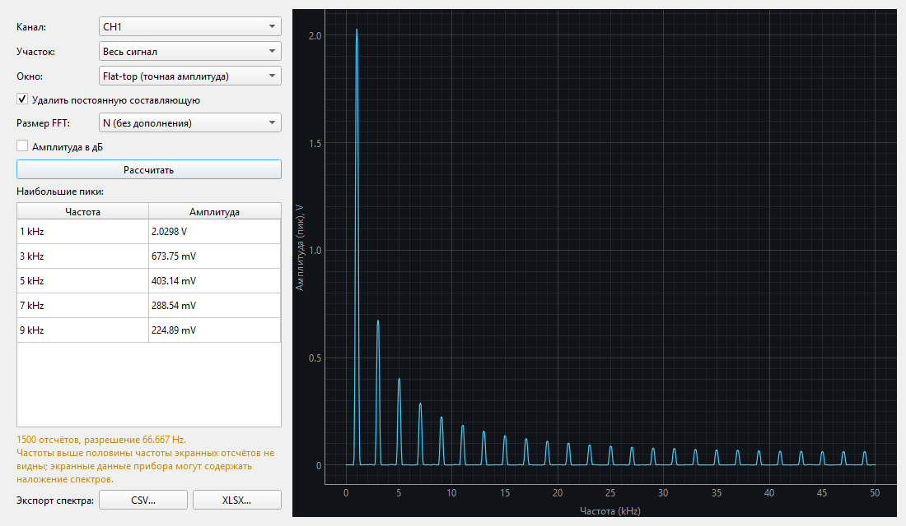
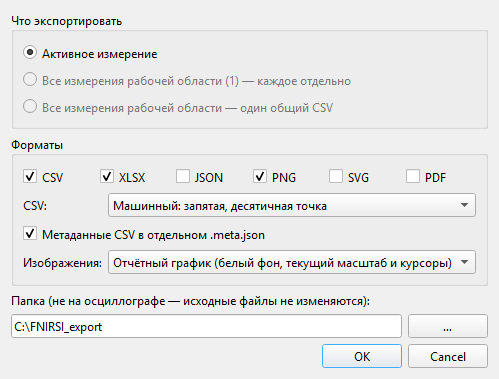

# Инструкция пользователя

## 1. Сохранить осциллограмму на приборе

| Модель | Как сохранить | Где искать файлы |
|---|---|---|
| 2C53T | кнопка снимка экрана: прибор пишет `N.bmp` и `N.bin` | корень диска прибора |
| 2C53P | снимок экрана | `Screenshot file\N.bmp` и `Screenshot simple file\N.bin` |
| 2C23T | снимок экрана (данных прибор не пишет) | `img_NN.bmp` в корне диска |
| 1013D | **SAVE WAVE** — данные и настройки, **SAVE PIC** — картинка | `N.wav`, `N.bmp` в корне диска |

У 1013D снимок и данные сохраняются разными кнопками и нумеруются независимо. Чтобы картинка
соответствовала данным, остановите прибор (STOP) и нажмите обе кнопки подряд.

## 2. Открыть файлы

1. Подключите прибор по USB — Windows видит его как флешку. В левой панели выберите его в списке
   **съёмных дисков** (или нажмите **Папка…** и укажите любую папку с файлами).
2. **Модель:** оставьте «Авто» — программа определит прибор по размеру файла и снимка. Для снимков
   2C23T и при неоднозначности выберите модель вручную.
3. В таблице файлов видно размер, дату и статус: **OK**, **предупр.** (файл прочитан, но есть замечания)
   или **ошибка** (с объяснением).
4. **Двойной щелчок** открывает файл. Кнопка **Добавить** кладёт выбранные файлы в рабочую область —
   для сравнения на одном графике. Для 2C53T/2C53P можно открыть и сам `.bmp`: программа найдёт
   к нему `.bin`.

Программа ничего не записывает на прибор. Если диск отключить, уже открытые измерения останутся.

## 3. Шкалы

Вкладка **Шкалы** (справа). Рядом с каждым значением — источник:

- **из файла данных** (1013D: всё хранится в WAV);
- **распознано по BMP** (2C53T, 2C53P, 2C23T: надписи «H=…», «…mV» и метка нуля на снимке);
- **введено вручную** — если вы поправили значение;
- **неизвестно** — тогда ось X показывается в номерах отсчётов, ось Y — в делениях,
  а в строке состояния появляется предупреждение.

В/дел вводится так, как показано на экране прибора (уже с учётом щупа X10).

## 4. График и курсоры

- Колесо мыши — масштаб, левая кнопка — перемещение, правая — масштаб по осям, `Ctrl+0` — сброс.
- Вкладка **Вид**: ось X (время / номер отсчёта), ось Y (вольты / деления / исходный код),
  каналы вместе или раздельно, точки отсчётов, толщина линий, сетка.
- `V` — вертикальные курсоры A и B, `H` — горизонтальные Y1 и Y2, `S` — привязка к отсчётам, `Esc` — сброс.
  Курсоры перетаскиваются мышью. Таблица на вкладке **Курсоры** показывает время, номер отсчёта,
  значения каналов, Δt, 1/|Δt| и ΔV.
- 1/|Δt| — это частота сигнала только если A и B стоят на одинаковых фазах соседних периодов.
- Наведите мышь на кривую — появится подсказка с ближайшим отсчётом обоих каналов;
  `Ctrl+Shift+C` копирует его в буфер обмена.

## 5. Автоматические измерения

Вкладка **Измерения**: минимум, максимум, размах, среднее, RMS, RMS переменной составляющей,
амплитуды, шаг отсчётов, период, частота, скважность. Наведите мышь на значение — увидите метод
расчёта. Уровень фронтов (середина размаха / среднее / вручную) и гистерезис настраиваются.
Если фронтов меньше двух или сигнал тонет в шуме — будет «Недостаточно данных» / «Не удалось определить».

## 6. Сверка со снимком

Вкладка **Снимок BMP** показывает картинку прибора с нанесёнными поверх декодированными точками
и восстановленный график в сетке экрана. Внизу — сколько отсчётов совпало с лучом, распознанные
надписи и положение метки нуля. Если снимок и данные не совпадают, шкалы со снимка не применяются.

Для 2C23T здесь же видно, как луч был оцифрован.

## 7. Сравнение и спектр

- Добавьте несколько файлов (кнопка **Добавить**) — они наложатся на одном графике. В «Рабочей
  области» можно выключать каналы, менять цвета и задавать сдвиги по X/Y (только для показа:
  в экспорт идут исходные координаты).
- `F` — окно спектра: канал, весь сигнал или участок между курсорами, окно, дополнение нулями
  (разрешение от этого не растёт — программа об этом пишет), таблица пиков, экспорт в CSV/XLSX.

## 8. Экспорт

`Ctrl+E`: активное измерение, все измерения по отдельности или один общий CSV.

- **CSV** — столбцы `time_s, sample_index, ch1_raw, ch1_div, ch1_V, …`; только известные столбцы.
  Машинный вариант (точка) или «для русского Excel» (`;` и запятая). Метаданные — в `.meta.json`.
- **XLSX** — листы Waveform, Measurements, Metadata (источник каждого параметра) и FFT.
- **JSON** — всё вместе в документированной структуре.
- **PNG / SVG / PDF** — отчётный график с осями, легендой, курсорами и предупреждениями
  или снимок области графика «как на экране».

`Ctrl+Shift+E` — пакетный экспорт выбранных файлов или всей папки; файл с ошибкой не останавливает пакет.

## 9. Сессии

`Ctrl+Shift+S` сохраняет сессию: пути к файлам, вид, курсоры, ручные шкалы, цвета и сдвиги.
`Ctrl+Shift+L` открывает её снова; недоступные файлы перечисляются в сообщении.
